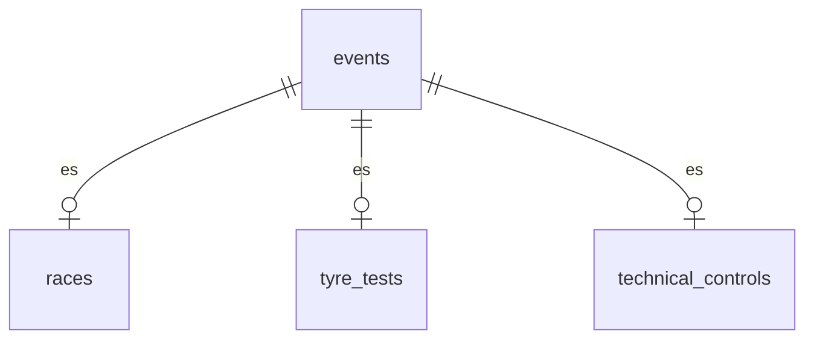

# 02 — Modelo de datos (Sprint 2)

Decisiones de modelo tomadas durante el Sprint 2. El documento equivalente del Sprint 1
(`docs/sprint1/02-modelo-de-datos.md`) queda congelado como registro histórico; lo que cambió
después vive acá.

## 1. Notificaciones = hechos puros (000010)

`notifications(id, user_id, event_id, read_at)`, con `event_id NOT NULL → events`.

- Una notificación es de un evento, **de cualquier tipo**: la base lo garantiza sin un `CHECK` de
  kinds.
- `title`, `body` y `kind` se eliminan: el texto y el tipo se **derivan al leer** del evento
  (nombre, fecha, tipo) y de la historia de publicación en `score_change_log`.
- La mensajería FIA↔escudería es otra cosa y tendrá su propia tabla; no comparte este `kind`.

## 2. Contexto del piloto (000011)

`drivers` guarda solo lo de la persona: `first_name`, `last_name`, `license_number`,
`country_code`, `deactivated_at` e `is_active` generada. Lo que depende del contexto se movió a
donde varía:

- **Rol titular/suplente — por período de pertenencia.** `driver_team_assignments` gana
  `is_starter`. Un cambio de rol o de equipo a mitad de temporada es una fila nueva
  (`effective_from`, append-only), nunca un edit.
- **Número de coche — por (piloto, temporada, categoría).** Tabla `season_drivers` (ex
  `driver_season_numbers`): `driver_id`, `season_id`, `category_id`, `number`. El número lo asigna
  el campeonato y sobrevive un cambio de equipo, por eso no tiene historial.
  - La categoría **no** se pide: es un dato derivado de la escudería del piloto, así que un
    trigger la materializa (mismo criterio que `score_entries.team_id` en 000008) y recién ahí
    `UNIQUE (season_id, category_id, number)` se sostiene en la base.
  - No se usa `UNIQUE (season_id, number)`: F1 y F2 numeran sus coches en forma independiente, así
    que el mismo número puede repetirse entre categorías de la misma temporada.

## 3. Jerarquía de eventos (000012–000015)

`events` es el padre **genérico y uniforme** (temporada, categoría, nombre, timing). Los atributos
propios de cada tipo viven en una tabla hija:

- `races` aporta `circuit`, `location`, `country_code`, `round` y la temporada/categoría
  denormalizadas para la unicidad de ronda.
- `technical_controls` aporta `control_type`.
- **El timing vive solo en `events`** (`starts_at`/`ends_at`): `races` y `tyre_tests` dejaron de
  duplicarlo (000015) y `technical_controls` nunca lo tuvo. Una sola fuente de horario para todo
  evento.
- `tyre_tests.event_id` es `NOT NULL` como el de las otras hijas: una prueba **es** un evento.

## 4. Integridad al cruzar tablas

La unicidad de un dato derivado que abarca dos tablas no se resuelve con un `UNIQUE` de una sola.
Dos patrones, según el caso:

- **Atributo directo del padre → FK compuesta.** La ronda es única por campeonato, pero
  `season_id`/`category_id` viven en el evento. `races` las copia y una FK compuesta a
  `events (id, season_id, category_id)` las mantiene honestas (`ON UPDATE CASCADE`), habilitando
  `UNIQUE (season_id, category_id, round)`. Es el mismo patrón de `drivers_id_team_unique` en
  000003.
- **Dato derivado por historial → trigger que lo materializa.** El número de piloto (§2), igual
  que el equipo del resultado en `000008`.

Reglas transversales mantenidas: `bigint GENERATED ALWAYS AS IDENTITY`, `CHECK` en la base, **baja
lógica** derivada (`deactivated_at` + `is_active` generada) en `users`, `drivers`, `categories`,
`teams` y `events`, y ningún `DELETE` en cascada sobre datos históricos.
