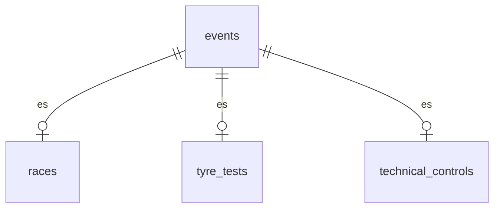

# 02 — Modelo de datos (Sprint 2)

Decisiones de modelo tomadas durante el Sprint 2. El documento equivalente del Sprint 1
(`docs/sprint1/02-modelo-de-datos.md`) queda congelado como registro histórico; lo que cambió
después vive acá.

## 1. Notificaciones = hechos puros (000010)

`notifications(id, user_id, event_id, read_at)`, con `event_id NOT NULL → events`.

- Una notificación es de un evento, **de cualquier tipo**: la base lo garantiza sin un `CHECK` de
  kinds.
- `title`, `body` y `kind` se eliminan: el texto y el tipo se **derivan al leer** del evento
  (nombre, fecha, tipo) y de la historia de publicación en `score_change_log`.
- La mensajería FIA↔escudería es otra cosa y tendrá su propia tabla; no comparte este `kind`.

## 2. Contexto del piloto (000011)

`drivers` guarda solo lo de la persona: `first_name`, `last_name`, `license_number`,
`country_code`, `deactivated_at` e `is_active` generada. Lo que depende del contexto se movió a
donde varía:

- **Rol titular/suplente — por período de pertenencia.** `driver_team_assignments` gana
  `is_starter`. Un cambio de rol o de equipo a mitad de temporada es una fila nueva
  (`effective_from`, append-only), nunca un edit.
- **Número de coche — por (piloto, temporada, categoría).** Tabla `season_drivers` (ex
  `driver_season_numbers`): `driver_id`, `season_id`, `category_id`, `number`. El número lo asigna
  el campeonato y sobrevive un cambio de equipo, por eso no tiene historial.
  - La categoría **no** se pide: es un dato derivado de la escudería del piloto, así que un
    trigger la materializa (mismo criterio que `score_entries.team_id` en 000008) y recién ahí
    `UNIQUE (season_id, category_id, number)` se sostiene en la base.
  - No se usa `UNIQUE (season_id, number)`: F1 y F2 numeran sus coches en forma independiente, así
    que el mismo número puede repetirse entre categorías de la misma temporada.

## 3. Jerarquía de eventos (000012–000015)

`events` es el padre **genérico y uniforme** (tipo, temporada, categoría, timing, baja lógica). Los
atributos propios de cada tipo viven en una tabla hija, cuya clave primaria es el `event_id` (§5):

- `races` aporta `round` y `circuit_id` (catálogo `circuits`, §5), más la temporada, la categoría y
  el estado activo del evento copiados para la unicidad de ronda.
- `technical_controls` aporta `control_type`, texto que carga el admin.
- `tyre_tests` no tiene atributos propios: marca el tipo y deja la regla "toda hija existe" uniforme.
- **El timing vive solo en `events`** (`starts_at`/`ends_at`): `races` y `tyre_tests` dejaron de
  duplicarlo (000015) y `technical_controls` nunca lo tuvo. Una sola fuente de horario para todo
  evento.
- `tyre_tests.event_id` es `NOT NULL` como el de las otras hijas: una prueba **es** un evento.

## 4. Integridad al cruzar tablas

La unicidad de un dato derivado que abarca dos tablas no se resuelve con un `UNIQUE` de una sola.
Dos patrones, según el caso:

- **Atributo directo del padre → FK compuesta.** La ronda es única por campeonato, pero
  `season_id`/`category_id` viven en el evento. `races` las copia y una FK compuesta a
  `events` las mantiene honestas (`ON UPDATE CASCADE`), habilitando el `UNIQUE` de la ronda (§5). Es el mismo patrón de `drivers_id_team_unique` en
  000003.
- **Dato derivado por historial → trigger que lo materializa.** El número de piloto (§2), igual
  que el equipo del resultado en `000008`.

Reglas transversales mantenidas: `bigint GENERATED ALWAYS AS IDENTITY`, `CHECK` en la base, **baja
lógica** derivada (`deactivated_at` + `is_active` generada) en `users`, `drivers`, `categories`,
`teams` y `events`, y ningún `DELETE` en cascada sobre datos históricos.

## 5. Integridad del calendario (000016)

Decisiones de la revisión del modelo, aplicadas editando `000016` (el esquema del Sprint 2 no está en
producción; requiere `make db-reset`).

- **Tipo con discriminador.** `events.kind` (`race`, `tyre_test`, `technical_control`) y cada hija
  fija el suyo con una columna constante (`event_kind`, `DEFAULT` + `CHECK`) y una FK compuesta a
  `events (id, kind)`. Es el patrón estándar de subtipo exclusivo: "un evento de un solo tipo" queda
  **declarativo** y es seguro bajo concurrencia, porque depende de un único valor en una única fila.
  Se evaluó eliminar `kind` y contar hijas con un trigger: funciona, pero con dos transacciones
  concurrentes se probó que un evento puede quedar con dos hijas si el trigger no bloquea la fila del
  padre. Se descartó: lo que se puede expresar con una FK no va a un trigger.
- **Exactamente una hija.** "Como mucho una" la dan la PK y la FK de tipo; "al menos una" no es
  expresable con FK ni `CHECK`, así que un `CONSTRAINT TRIGGER` diferido lo verifica al commit (se
  inserta el evento y su hija en la misma transacción). Solo un bug del backend lo puede disparar, por
  eso no tiene código `RC` propio: un 500 es la respuesta correcta.
- **PK compartida.** La hija no tiene id propio: `event_id` es su clave primaria. Nada referenciaba el
  id de la hija, y así una carrera tiene un solo id.
- **Ronda única entre las carreras activas.** La baja lógica vive en `events`, pero la ronda en
  `races`. Para que una carrera dada de baja libere su ronda, `races` copia el estado activo del
  evento (`event_is_active`) y una sola FK compuesta a `events (id, kind, season_id, category_id,
  is_active)` con `ON UPDATE CASCADE` mantiene honestas todas las copias. El `UNIQUE (season_id,
  category_id, round)` es parcial: `WHERE event_is_active`. `round` se queda en `races` (es un atributo
  de la carrera, no del evento).
- **Sin nombre almacenado.** Se eliminó `events.name`. La etiqueta la compone el backend por tipo: la
  carrera con el nombre del GP del circuito y la ronda, el control con su `control_type`, la prueba de
  neumáticos con un texto fijo y la fecha. Un solo lugar, testeable, y el texto en español no entra a
  las migraciones.
- **Catálogo `circuits`.** `name` (único), `gp_name`, `locality`, `country_code` y baja lógica. Es
  dato de referencia (`seeds/reference.sql`, los 24 circuitos de 2026): en producción hace falta para
  crear carreras. Se asume un GP por circuito; si un circuito albergara GP distintos por categoría,
  `gp_name` pasaría al evento.
- **Carrera disputada y equipo derivado.** Una carrera con resultados no cambia su fecha ni se da de
  baja (`RC001`, el servicio responde `409`): sus resultados quedarían colgando de un evento que nadie
  ve. El equipo del resultado se re-deriva en cada escritura.
