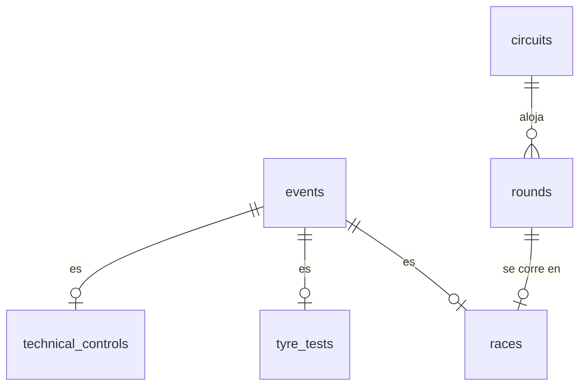

# 02 — Modelo de datos (Sprint 2)

Decisiones de modelo tomadas durante el Sprint 2. El documento equivalente del Sprint 1
(`docs/sprint1/02-modelo-de-datos.md`) queda congelado como registro histórico; lo que cambió
después vive acá.

## 1. Notificaciones = hechos puros (000010)

`notifications(id, user_id, event_id, read_at)`, con `event_id NOT NULL → events`.

- Una notificación es de un evento, **de cualquier tipo**: la base lo garantiza sin un `CHECK` de
  kinds.
- `title`, `body` y `kind` se eliminan: el texto y el tipo se **derivan al leer** del evento
  (nombre, fecha, tipo) y de la historia de publicación en `score_change_log`.
- La mensajería FIA↔escudería es otra cosa y tendrá su propia tabla; no comparte este `kind`.

## 2. Contexto del piloto (000011)

`drivers` guarda solo lo de la persona: `first_name`, `last_name`, `license_number`,
`country_code`, `deactivated_at` e `is_active` generada. Lo que depende del contexto se movió a
donde varía:

- **Rol titular/suplente — por período de pertenencia.** `driver_team_assignments` gana
  `is_starter`. Un cambio de rol o de equipo a mitad de temporada es una fila nueva
  (`effective_from`, append-only), nunca un edit.
- **Número de coche — por (piloto, temporada, categoría).** Tabla `season_drivers` (ex
  `driver_season_numbers`): `driver_id`, `season_id`, `category_id`, `number`. El número lo asigna
  el campeonato y sobrevive un cambio de equipo, por eso no tiene historial.
  - La categoría **no** se pide: es un dato derivado de la escudería del piloto, así que un
    trigger la materializa (mismo criterio que `score_entries.team_id` en 000008) y recién ahí
    `UNIQUE (season_id, category_id, number)` se sostiene en la base.
  - No se usa `UNIQUE (season_id, number)`: F1 y F2 numeran sus coches en forma independiente, así
    que el mismo número puede repetirse entre categorías de la misma temporada.

## 3. Jerarquía de eventos (000012–000015)

`events` es el padre **genérico y uniforme**: solo lo que comparten todos los tipos (tipo, timing,
baja lógica). Lo demás, incluido el campeonato, vive en una tabla hija cuya clave primaria es el
`event_id` (§5):

- `races` apunta a su `round` (`rounds`: temporada, categoría, número, circuito y nombre del GP) y
  toma el campeonato de ahí.
- `technical_controls` aporta `control_type` (texto que carga el admin) y su temporada y categoría.
- `tyre_tests` aporta su temporada, su categoría y el circuito donde se corre: la consigna pide que
  escuderías y público puedan consultarla.
- **El timing vive solo en `events`** (`starts_at`/`ends_at`): `races` y `tyre_tests` dejaron de
  duplicarlo (000015) y `technical_controls` nunca lo tuvo. Una sola fuente de horario para todo
  evento.
- `tyre_tests.event_id` es `NOT NULL` como el de las otras hijas: una prueba **es** un evento.

## 4. Integridad al cruzar tablas

La unicidad de un dato derivado que abarca dos tablas no se resuelve con un `UNIQUE` de una sola.
Dos patrones, según el caso:

- **Mover el dato a donde vive la unicidad.** La ronda es única por campeonato, así que `rounds`
  guarda temporada, categoría y número juntos y el `UNIQUE` es de una sola tabla (§5). Antes
  (000014) `races` copiaba temporada y categoría del evento con una FK compuesta; el rediseño de
  000016 eliminó esa copia.
- **Dato derivado por historial → trigger que lo materializa.** El número de piloto (§2), igual
  que el equipo del resultado en `000008`.

Reglas transversales mantenidas: `bigint GENERATED ALWAYS AS IDENTITY`, `CHECK` en la base, **baja
lógica** derivada (`deactivated_at` + `is_active` generada) en `users`, `drivers`, `categories`,
`teams`, `events`, `rounds` y `circuits`, y ningún `DELETE` en cascada sobre datos históricos.

## 5. Integridad del calendario (000016)

Decisiones de la revisión del modelo, aplicadas editando `000016` (el esquema del Sprint 2 no está en
producción; requiere `make db-reset`).

- **Tipo con discriminador.** `events.kind` (`race`, `tyre_test`, `technical_control`) y cada hija
  fija el suyo con una columna constante (`event_kind`, `DEFAULT` + `CHECK`) y una FK compuesta a
  `events (id, kind)`. Es el patrón estándar de subtipo exclusivo: "un evento de un solo tipo" queda
  **declarativo** y es seguro bajo concurrencia, porque depende de un único valor en una única fila.
  Se evaluó eliminar `kind` y contar hijas con un trigger: funciona, pero con dos transacciones
  concurrentes se probó que un evento puede quedar con dos hijas si el trigger no bloquea la fila del
  padre. Se descartó: lo que se puede expresar con una FK no va a un trigger.
- **Exactamente una hija.** "Como mucho una" la dan la PK y la FK de tipo; "al menos una" no es
  expresable con FK ni `CHECK`, así que un `CONSTRAINT TRIGGER` diferido lo verifica al commit (se
  inserta el evento y su hija en la misma transacción). Solo un bug del backend lo puede disparar, por
  eso no tiene código `RC` propio: un 500 es la respuesta correcta. Un tipo que se agregue al `CHECK`
  sin agregarse al trigger hace fallar al evento en lugar de dejarlo pasar sin hija.
- **PK compartida.** La hija no tiene id propio: `event_id` es su clave primaria. Nada referenciaba el
  id de la hija, y así una carrera tiene un solo id.
- **El campeonato es de la hija.** `events` guarda solo tipo y timing; `tyre_tests` y
  `technical_controls` tienen su `season_id`/`category_id` propios, y `races` los toma de su ronda.
  Ninguna columna es copia de otra, así que no hay nada que sincronizar.
- **Tabla `rounds`.** Temporada, categoría, número, circuito y nombre del GP. El número es único entre
  las rondas **activas** del campeonato (índice parcial sobre la propia tabla): si la FIA cancela la
  ronda 5 y arma otra ronda 5, la vieja queda dada de baja y libera el número, sin copiar el estado a
  ninguna otra tabla. Se evaluó antes copiar el estado activo del evento en `races` con una FK
  compuesta; `rounds` lo resuelve sin copia.
- **Una carrera por ronda.** La consigna no tiene sprints, así que `races_round_id_unique` deja una
  sola carrera por ronda. Si una entrega futura pidiera carreras sprint, alcanza con quitar esa
  restricción y distinguir la sesión.
- **Puntajes solo sobre carreras (B.1).** `score_entries` y `score_change_log` apuntan a
  `races (event_id)` en lugar de `events`: una prueba de neumáticos o un control técnico no pueden
  recibir puntos. Los acuses cuelgan del log, así que también quedan cubiertos. `notifications` sigue
  apuntando a `events`: cualquier tipo de evento se puede notificar. B.2 (quién puede acusar) sigue
  pendiente.
- **Pendiente conocido.** Nada en la base impide una carrera activa **sin resultados** sobre una ronda
  dada de baja: cancelar la ronda y dar de baja su carrera lo hace el servicio en la misma
  transacción. Con resultados, la base lo impide (punto siguiente).
- **Sin nombre almacenado.** Se eliminó `events.name`. La etiqueta la compone el backend por tipo: la
  carrera con el nombre del GP de su ronda y el número, el control con su `control_type`, la prueba de
  neumáticos con un texto fijo y la fecha. Un solo lugar, testeable, y el texto en español no entra a
  las migraciones.
- **Catálogo `circuits`.** `name` (único), `locality`, `country_code` y baja lógica. Es dato de
  referencia (`seeds/reference.sql`, los 24 circuitos de 2026): en producción hace falta para crear
  rondas. El nombre del GP no está acá sino en la ronda, porque un mismo circuito puede albergar GP
  con distinto nombre según la categoría o el año.
- **Carrera disputada y equipo derivado.** Una carrera con resultados ya se corrió: lo que la ubica
  queda fijo. No cambia su fecha ni se da de baja, no cambia de ronda, y su ronda no cambia de
  temporada, categoría ni circuito ni se cancela (`RC001`, el servicio responde `409`); si no, los
  resultados pasarían a otra fecha, otra tabla de posiciones u otro circuito, o colgarían de algo que
  nadie ve. El número de ronda y el nombre del GP siguen editables: las rondas se renumeran tras una
  cancelación y un error de tipeo se tiene que poder corregir. El equipo del resultado se re-deriva en
  cada escritura.
- **Regla en el servicio, no en la base.** "La fecha del evento cae dentro de su temporada" abarca
  `events`, `races`, `rounds`, `tyre_tests` y `technical_controls`; hacerla cumplir en la base
  exigiría cinco triggers diferidos. La valida el servicio en cada escritura.

## 6. Puntajes y nombres (000018)

Migración aditiva sobre `000017` (no requiere `make db-reset`).

- **Categoría del puntaje.** El trigger que deriva el equipo del resultado también exige que ese
  equipo corra en la categoría de la ronda de la carrera: un piloto de F2 no puntúa en una carrera de
  F1. Usa `RC002`, porque es un error de carga del admin y el servicio lo responde con un 4xx.
- **Un ítem por piloto en cada cambio.** `UNIQUE (change_log_id, driver_id)` en
  `score_change_log_items`: dos líneas del mismo piloto dejarían ambiguos los puntos viejos y nuevos.
- **Duración positiva.** `ends_at > starts_at`: un evento que termina cuando empieza no significa
  nada en un calendario.
- **Nombres de `season_drivers`.** `000013` había renombrado la tabla pero no sus restricciones,
  índice, secuencia, triggers ni función.

Quedan para su user story (detalle en `docs/sprint2/sprint.md`): el trigger de auditoría de puntajes
(US9), `season_drivers` por categoría y el cierre y la retroactividad de las asignaciones (US11), y
el tipo de notificación y la validación del acuse (US24). Se descartaron: guardar posición y estado
(DNF, DSQ), porque la consigna solo pide puntajes y `000006` deriva la posición de los puntos;
índices sin una query que los use; quitar las columnas `is_active`, que son convención del proyecto;
y la zona horaria del circuito, que ninguna historia pide.

